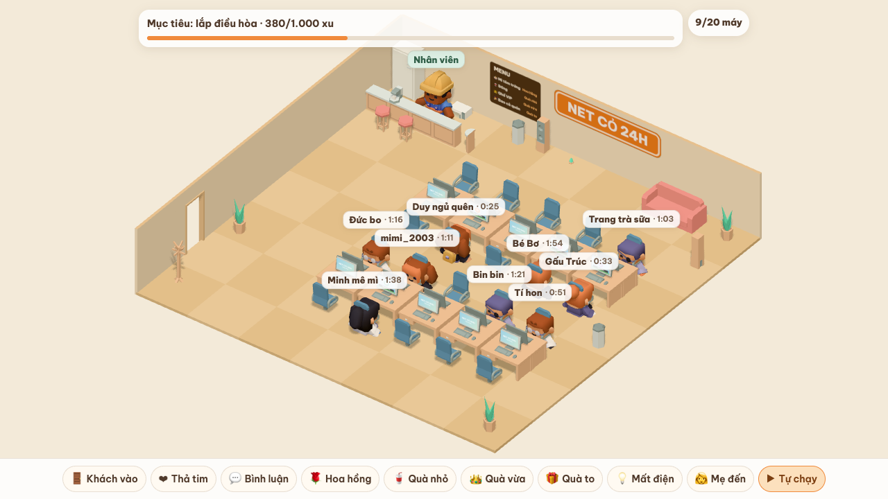

# Quán Net Live

Quán net 3D với 20 máy, có khách ra vào, gọi món và các sự kiện vui.
Chạy giả lập để xem thử hoặc nối TikTok LIVE để nhận tim, bình luận và quà từ người xem.
Hướng dẫn đưa game lên sóng: [docs/len-song.md](docs/len-song.md).



## 1. Cài đặt

1. Cài **Node.js 20+**; Vite hiện tại cần **20.19+ trong nhánh 20**, hoặc **22.12+**.
2. Mở terminal tại thư mục dự án, cài phần game:

   ```sh
   npm install
   ```

3. Cài phần server:

   ```sh
   cd server && npm install
   ```

## 2. Chạy game

1. **Chỉ xem/giả lập:** mở terminal tại thư mục gốc, chạy `npm run dev`, rồi mở http://localhost:5173. Quán tự chạy giả lập.
2. **Có TikTok:** chép `.env.example` thành `.env` tại thư mục gốc, thay `TIKTOK_USERNAME` bằng username TikTok của bạn (có hoặc không có `@`). Mở hai cửa sổ terminal, đều bắt đầu tại thư mục gốc:
   - Cửa sổ 1: `cd server && npm start`.
   - Cửa sổ 2: `npm run dev`, rồi mở http://localhost:5173.
3. Tài khoản phải **đang LIVE** thì server mới nối được. Khi đã nối, góc trên hiện chip đỏ **“● LIVE @tên”**. Nếu gặp lỗi giới hạn/ký (sign), lấy key miễn phí tại [eulerstream.com](https://eulerstream.com), thêm `SIGN_API_KEY=key_cua_ban` vào `.env`, rồi khởi động lại server.
4. **Thử đường truyền không cần LIVE:** thay lệnh ở cửa sổ 1 bằng `cd server && npm run fake`. Chế độ này phát sự kiện thử qua server và cũng hiện chip đỏ; đây chưa phải kết nối TikTok thật. Không chạy `fake` và `start` cùng cổng.

Nếu đổi `PORT` trong `.env`, phải sửa cả `live.port` trong `src/config.js` cho giống nhau (mặc định `8787`).

## 3. Phím tắt

1. **H:** ẩn/hiện thanh giả lập; ẩn thanh không dừng tự chạy.
2. **M:** tắt/bật tiếng. Bấm vào trang trước để trang nhận phím và cho phép phát âm thanh.
3. Mở http://localhost:5173/?clean để thanh giả lập ẩn sẵn; giả lập vẫn tự chạy theo cấu hình.
4. Mở http://localhost:5173/?clean&safe (cửa sổ dọc) để xem trước vùng bị giao diện TikTok che trên điện thoại.

## 4. Đổi cấu hình

Mở `src/config.js`, sửa giá trị rồi lưu; các khoảng thời gian dưới đây tính bằng giây.

| Mục | Tên trong cấu hình | Mặc định / ý nghĩa |
| --- | --- | --- |
| Giây mỗi tim | `secondsPerLike` | 5 giây/tim |
| Giờ khởi đầu | `startSeconds`, `lockGraceSeconds` | 60 giây khi vào; 20 giây cứu máy khi hết giờ |
| Hoa hồng → mì trứng | `gifts.rose` | `item: 'noodle'`; tên `Rose`; ngưỡng 1 kim cương; +30 giây, 1 xu giả lập |
| Quà nhỏ → Sting | `gifts.small` | `item: 'sting'`; tên `TikTok`, `Finger Heart`, `Ice Cream Cone`, `GG`, `Heart Me`; ngưỡng 5 kim cương; +60 giây, 5 xu giả lập |
| Quà vừa → ghế VIP | `gifts.medium` | `item: 'vip'`; tên `Hand Hearts`, `Doughnut`, `Perfume`; ngưỡng 99 kim cương; +300 giây, 99 xu giả lập |
| Quà to → bao cả quán | `gifts.big` | `item: 'all'`; tên `Galaxy`, `Lion`, `Universe`, `Interstellar`; ngưỡng 500 kim cương; +120 giây, 500 xu giả lập |
| Mục tiêu xu | `goals`, `startCoins` | Bắt đầu 380 xu; 1.000 xu lắp điều hòa; 5.000 xu là mốc “mở tầng 2” (chưa có tầng mới) |
| Tần suất sự kiện | `randomEventMin`, `randomEventMax` | Mỗi 30–60 giây khi tự chạy |
| Sự kiện ngẫu nhiên | `events` | Tỉ lệ chọn từng sự kiện (`weights`); Giờ vàng (tim x2 thời gian), Shipper (mời trà đá ngẫu nhiên vài khách), Solo (người xem bình luận 1/2 để cổ vũ, người thắng +2 phút) |
| Lưu tiến độ | `persist` | Lưu xu mục tiêu + bảng xếp hạng, tải lại trang không mất; tự bắt đầu lại sau 8 giờ; mở `?reset` để xóa ngay |
| Mất điện | `blackout.likesNeeded`, `blackout.autoRecoverSeconds` | Cần 30 tim hoặc tự sáng lại sau 14 giây |
| Mẹ đến | `mom.scoldSeconds` | Mắng trong 9 giây |
| Giả lập | `autoRun`, `sim` | Tự chạy bật sẵn; 9 khách ban đầu; khoảng cách giữa lượt vào/tim/chat/quà nằm trong `sim` |
| Camera | `camera` | Ưu tiên lia cam (`priority`: mẹ đến > quà to > VIP > khóa máy > khách mới > quà nhỏ; 0 = không lia), thời gian mỗi cảnh, giãn cách lia theo khách mới (`joinCooldown`), zoom khung dọc, vùng an toàn (`portraitSafe`) |
| Hàng chờ | `queue` | Khi kín 20 máy: tối đa 8 người đứng chờ dọc tường trái; thả tim được lên trước, tặng quà lên đầu hàng; chờ quá 150 giây thì về |
| Hướng dẫn | `hints` | Các câu hướng dẫn cách chơi hiện lần lượt (`{tim}` tự thay bằng số giây mỗi tim); `enabled: false` để tắt |
| Nhãn | `ui` | Chống chồng nhãn; khung dọc chỉ hiện đồng hồ khi sắp hết giờ |
| Live | `live` | Bật nối server; cổng `8787`; `simWhileLive: true` cho chạy giả lập song song, chậm 2,5 lần; tối đa 5 món/combo qua `maxRepeatPerGift` |

1. Để thêm tên quà TikTok, tìm `tiktokNames` của nhóm muốn nhận quà, thêm tên tiếng Anh do TikTok gửi về trong dấu nháy, ngăn bằng dấu phẩy. Ví dụ: `tiktokNames: ['Rose', 'Ten Qua Moi']`.
2. Game ưu tiên khớp tên (không phân biệt hoa/thường). Nếu tên chưa có, game xét **tổng kim cương của cả combo**, chọn nhóm có `minDiamonds` cao nhất đạt được. Các ngưỡng trong bảng là cấu hình nhận diện, không phải bảng giá quà TikTok.
3. Trong mỗi nhóm, `seconds` là giây cộng, `coins` là xu giả lập. Khi nhận quà thật, xu mục tiêu lấy theo kim cương thực nhận.

## 5. Đổi tên quán

1. Sửa `shopName` trong `src/config.js`: biển hiệu và màn hình máy trống tự dùng tên mới.
2. Đổi tên tab trình duyệt tại thẻ `<title>` trong `index.html`.

## 6. Bản build tĩnh

1. Tại thư mục gốc, chạy `npm run build`; kết quả nằm trong `dist/`.
2. Phục vụ `dist/` bằng máy chủ web; có thể xem thử bằng `npm run preview` rồi mở địa chỉ terminal báo. Kết nối TikTok **vẫn cần server Node chạy riêng**.

## 7. Thư mục chính và nguồn model

- `src/`: game, cảnh 3D, giao diện, giả lập và kết nối live; cấu hình tại `src/config.js`.
- `server/`: nhận sự kiện TikTok và chuyển sang game.
- `public/models/`: model đang dùng; `assets/kenney/`: thư viện model gốc.
- `screenshots/`: ảnh minh họa; `docs/len-song.md`: hướng dẫn lên sóng.
- `.env.example`: mẫu cấu hình server; `dist/`: bản xuất sau khi build.

Model từ **Kenney**, giấy phép **CC0**: được dùng thương mại, không bắt buộc ghi nguồn.
